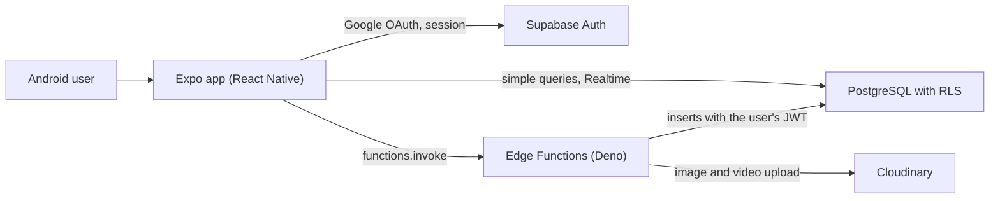
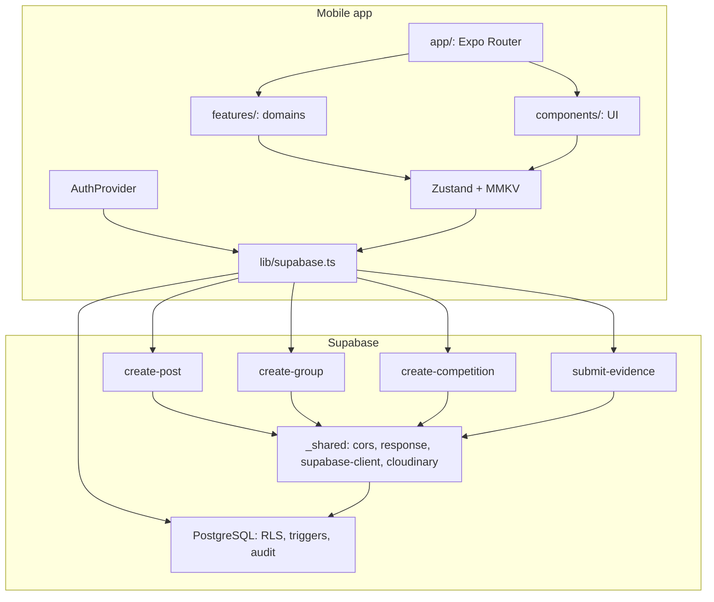
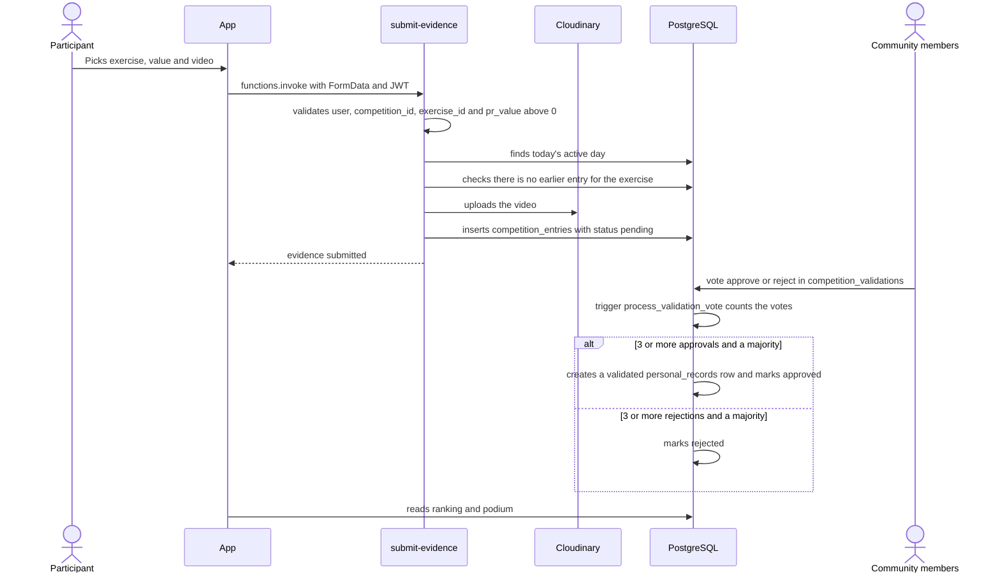

# Living Sport architecture

English · [Español](./architecture.md)

Documents the `develop` branch. The mobile app (Expo Router) talks to Supabase in two ways: reads and simple operations straight from the client, and multi-step operations through Edge Functions. The competition validation rules live in the database as triggers.

## Context



## Components



## Main flow: competition evidence and validation



## Data flow

- **Reads:** screens read through the Supabase client and keep the result in Zustand stores. The session uses SecureStore and the local cache uses MMKV. `profiles` is published to Realtime and the app listens on the `profile:<userId>` channel.
- **Simple writes:** done straight from the client, protected by RLS.
- **Multi-step writes:** go through an Edge Function (`create-post`, `create-group`, `create-competition`, `submit-evidence`). Each function validates the JWT with `getUser`, validates the input, uploads the file to Cloudinary when there is media, and writes to the database.
- **Validation business rules:** the `competition_validations_no_self` trigger (nobody validates their own entry) and `competition_validations_process` (vote count and status change) are in the `20260401015014_groups_competitions.sql` migration.
- **Audit:** the `audit` schema records table changes through triggers.

## Folder structure

```text
app/
  (auth)/login.tsx          Google sign-in
  (tabs)/                   feed, communities, profile
  community/[id].tsx        community detail
  competition/              create and view a competition
  routine/                  daily routine and AI screen (placeholder)
features/                   communities, competitions, feed, notifications, profile
components/                 feed, community, competition, ui, shared
providers/                  AuthProvider, theme
lib/                        Supabase client, MMKV
supabase/
  migrations/               extensions, catalogs, profiles, feed, groups and competitions
  functions/                create-post, create-group, create-competition, submit-evidence, _shared, tests
  tests/                    001 to 009 (schema, RLS, triggers)
```

## Key decisions

- **Expo Router and file-based routes.** `app/_layout.tsx` controls the session and redirects between `(auth)` and `(tabs)`.
- **Edge Functions for multi-step logic.** The project rule: if an operation chains inserts, validations and side effects, it goes in a function; a single operation goes straight from the client.
- **Peer validation inside the database.** Counting votes and issuing the verified record in a trigger keeps data consistent without relying on the client to get the steps right. The 3-vote threshold is fixed in the SQL function.
- **RLS and audit on every table.** The migrations enable RLS and audit triggers; SQL tests 001 to 009 cover the schema and the policies.
- **Cloudinary for media.** Functions upload the files and store only the URL.
- **Automated releases.** Conventional commits, semantic-release on `main` and EAS profiles for APKs.
- **Migration to `features/`.** The project is moving from flat folders to domains; new code goes in `features/`.

## In development

- AI routines (Gemini prototype on the `feature/ai-routines` branch, not integrated).
- Weekly podium with redeemable rewards.
