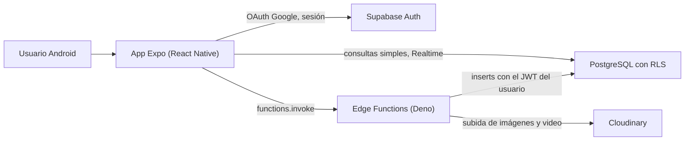
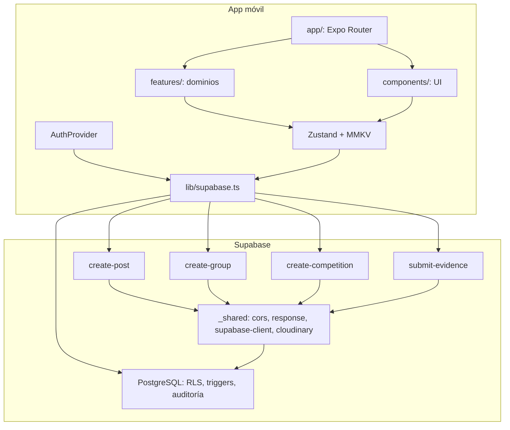
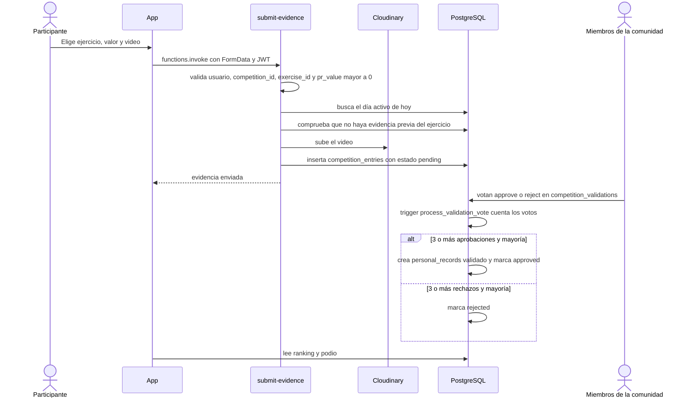

# Arquitectura de Living Sport

[English](./architecture.en.md) · Español

Documenta la rama `develop`. La app móvil (Expo Router) habla con Supabase de dos formas: lecturas y operaciones simples directo desde el cliente, y operaciones de varios pasos a través de funciones Edge. Las reglas de validación de competencias viven en la base de datos como triggers.

## Contexto



## Componentes



## Flujo principal: evidencia de competencia y validación



## Flujo de datos

- **Lectura:** las pantallas leen con el cliente de Supabase y guardan el resultado en stores de Zustand. La sesión usa SecureStore y la caché local, MMKV. `profiles` está publicada en Realtime y la app escucha el canal `profile:<userId>`.
- **Escritura simple:** se hace directo desde el cliente, protegida por RLS.
- **Escritura con varios pasos:** va por función Edge (`create-post`, `create-group`, `create-competition`, `submit-evidence`). Cada función valida el JWT con `getUser`, valida la entrada, sube el archivo a Cloudinary cuando hay media y escribe en la base.
- **Reglas de negocio de la validación:** los triggers `competition_validations_no_self` (nadie valida su propia evidencia) y `competition_validations_process` (conteo de votos y cambio de estado) están en la migración `20260401015014_groups_competitions.sql`.
- **Auditoría:** el esquema `audit` registra cambios de las tablas mediante triggers.

## Estructura de carpetas

```text
app/
  (auth)/login.tsx          inicio de sesión con Google
  (tabs)/                   feed, comunidades, perfil
  community/[id].tsx        detalle de comunidad
  competition/              crear y ver competencia
  routine/                  rutina por día y pantalla de IA (marcador)
features/                   communities, competitions, feed, notifications, profile
components/                 feed, community, competition, ui, shared
providers/                  AuthProvider, tema
lib/                        cliente Supabase, MMKV
supabase/
  migrations/               extensiones, catálogos, perfiles, feed, grupos y competencias
  functions/                create-post, create-group, create-competition, submit-evidence, _shared, tests
  tests/                    001 a 009 (esquema, RLS, triggers)
```

## Decisiones clave

- **Expo Router y rutas por archivo.** `app/_layout.tsx` controla la sesión y redirige entre `(auth)` y `(tabs)`.
- **Edge Functions para lógica de varios pasos.** La regla del proyecto: si una operación encadena inserts, validaciones y efectos secundarios, va en una función; si es una sola operación, directo desde el cliente.
- **Validación entre pares dentro de la base.** Contar votos y emitir el récord verificado en un trigger mantiene la consistencia sin depender de que el cliente haga bien los pasos. El umbral de 3 votos está fijo en la función SQL.
- **RLS y auditoría en todas las tablas.** Las migraciones habilitan RLS y triggers de auditoría; las pruebas SQL 001 a 009 cubren el esquema y las políticas.
- **Cloudinary para media.** Las funciones suben los archivos y guardan solo la URL.
- **Releases automáticos.** Commits convencionales, semantic-release en `main` y perfiles de EAS para APK.
- **Migración a `features/`.** Se está pasando de carpetas planas a dominios; el código nuevo va en `features/`.

## En desarrollo

- Rutinas con IA (prototipo con Gemini en la rama `feature/ai-routines`, sin integrar).
- Podio semanal con recompensas canjeables.
